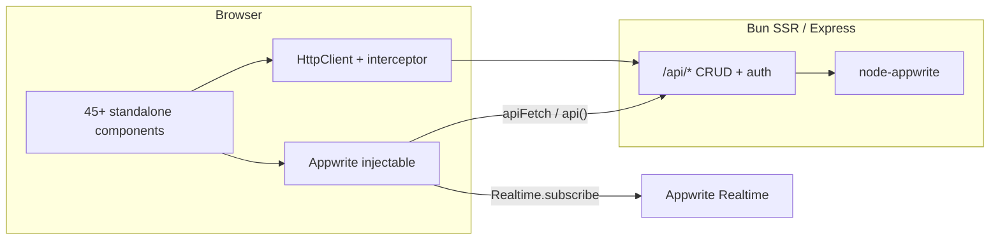
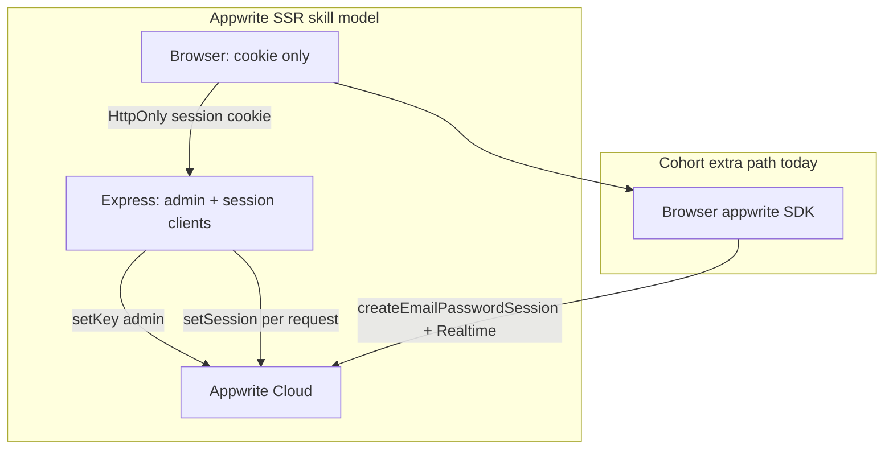

# Angular Frontend Audit — lxv CRM (`/home/titan/apps/lxv/cohort`)

## Scope and stack (verified)

| Area | Finding |
|------|---------|
| Angular | **21.2.x** (`@angular/*` ^21), standalone components, `@angular/build:application`, SSR via [`src/server.ts`](src/server.ts) + [`app.config.server.ts`](src/app/app.config.server.ts) |
| Package manager | **bun@1.4.2** per [`package.json`](package.json) / [`AGENTS.md`](AGENTS.md) |
| UI | Tailwind **4** CSS-first ([`src/styles.css`](src/styles.css)), Angular Material icons, inline templates in ~45 feature components |
| Data | Hybrid: [`Appwrite`](src/app/appwrite.ts) facade (~1,540 LOC) calling same-origin `/api/*` via [`apiFetch`](src/lib/api-client.ts); browser Appwrite SDK still used for **Realtime** |
| Appwrite SDK | Browser: `appwrite` v26 (`Client`, `Databases`, `Realtime`); server: `node-appwrite` with admin + per-request session clients ([`appwrite-clients.ts`](src/server/appwrite-clients.ts), [`auth.ts`](src/server/auth.ts)) — aligns with SSR skill **partially** |
| Routing | Lazy `loadComponent` for all routes ([`app.routes.ts`](src/app/app.routes.ts)); `withViewTransitions` + `withComponentInputBinding` in [`app.config.ts`](src/app/app.config.ts) |
| Signal forms | **Not applicable yet** (Angular 21); project correctly uses reactive + template-driven forms today |

---

## What is working well

1. **Standalone + lazy routes** — consistent `loadComponent` pattern keeps initial bundle scoped; route table is complete and readable.
2. **OnPush nearly universal** — 43/45 `@Component` files use `ChangeDetectionStrategy.OnPush`; templates heavily use `@if` / `@for` control flow.
3. **Signals in hot paths** — dashboard, leads, notes, forecast, etc. use `signal` / `computed`; root shell ([`app.ts`](src/app/app.ts)) is signal-driven.
4. **Backend proxy direction** — CRUD in `appwrite.ts` goes through `/api` with cookies + `x-team-id` ([`api.interceptor.ts`](src/app/api.interceptor.ts), [`api-client.ts`](src/lib/api-client.ts)); aligns with [`docs/codebase/RECONCILIATION.md`](docs/codebase/RECONCILIATION.md).
5. **SSR-aware fetch** — `fetchInitialData()` short-circuits on server with mocks ([`appwrite.ts`](src/app/appwrite.ts) ~780), avoiding browser-only API during prerender/SSR.
6. **Tooling baseline** — ESLint + `angular-eslint` selector rules ([`eslint.config.js`](eslint.config.js)); Vitest wired via `ng test`; production budgets in [`angular.json`](angular.json).
7. **Server Appwrite SSR pattern** — Admin + per-request session clients, cookie session middleware, and `Role.team` row permissions in [`appwrite-schema.ts`](src/server/appwrite-schema.ts) match the **appwrite-typescript** SSR skill; keep this as the only authoritative server integration style.

---

## Critical issues (P0 — fix before production hardening)

### 1. Hardcoded third-party keys in the client bundle

- [`lead-map.component.ts`](src/app/lead-map.component.ts) falls back to a **literal Google Maps API key** when `/api/config/maps` fails (lines ~409–414).
- [`email-marketing.service.ts`](src/app/email-marketing.service.ts) embeds mock Mailchimp/SendGrid/HubSpot-style keys in source.
- [`appwrite.ts`](src/app/appwrite.ts) mock function-variable payload includes a truncated Gemini key pattern in demo data.

**Risk:** keys in git history, quota abuse, CSP/third-party lock-in. **Fix:** server-only config; client shows “Maps unavailable” UI; no string fallbacks in frontend.

### 2. Default Appwrite project IDs in client

[`DEFAULT_CONFIG`](src/app/appwrite.ts) hardcodes Toronto endpoint + `projectId` / collection IDs. Acceptable for a public Appwrite **project ID**, but couples all environments to one tenant and contradicts “secrets off client” intent for multi-env deploys.

**Fix:** inject build-time `APPWRITE_*` public config (or `/api/config/public`) and remove baked-in IDs from defaults except local dev `.env` story.

### 3. No route guards

[`app.routes.ts`](src/app/app.routes.ts) has **zero** `canActivate` / `CanMatch` guards. Auth is implicit via `Appwrite` `effect()` after bootstrap — deep links render feature shells before session is known.

**Fix:** functional guard reading `/api/auth/me` (or `Appwrite.currentUser` signal) + redirect to login/settings.

---

## High issues (P1 — architecture and Angular 21 correctness)

### 4. Zoneless documented but not explicitly configured

Docs ([`AGENTS.md`](AGENTS.md), [`BUN-DEV.md`](docs/codebase/BUN-DEV.md)) claim zoneless; **`provideZonelessChangeDetection()` is absent** from [`app.config.ts`](src/app/app.config.ts). `zone.js` is not in `package.json` (optional peer only).

**Risk:** ambiguous CD behavior across Angular minor upgrades; subtle “UI not updating” bugs where code still assumes Zone (e.g. some `subscribe` callbacks without `markForCheck` — none found, but subscriptions exist).

**Fix:** add `provideZonelessChangeDetection()` to browser + merged server config; document in one canonical file.

### 5. No client hydration provider

[`SYSTEM_DOCUMENTATION.md`](SYSTEM_DOCUMENTATION.md) mentions hydration; **`provideClientHydration()` is not registered**. SSR mode is `RenderMode.Server` for all paths ([`app.routes.server.ts`](src/app/app.routes.server.ts)).

**Risk:** full re-render on client, duplicate network work, flicker on slow networks.

**Fix:** enable hydration (and event replay if needed for click handlers); validate Google Maps / Realtime paths are browser-only.

### 6. God service anti-pattern — `Appwrite` injectable

Single file owns auth, CRUD, Realtime, storage, functions, mock fallbacks, provisioning UX, and global entity caches. **~40 components** import `Appwrite` directly instead of domain services.

**Fix (phased):** split into `AuthSessionService`, `CrmEntityStore` (or per-entity services already partially present: [`lead.service.ts`](src/app/lead.service.ts)), `RealtimeSyncService`; keep `Appwrite` as thin deprecated facade during migration.

### 7. Schema drift vs reconciliation doc

`fetchInitialData` still queries **`workflows`** collection ([`appwrite.ts`](src/app/appwrite.ts) ~820); reconciliation says use **`email_workflows`** and remove legacy `workflows`.

**Fix:** align client fetch + signals with server table IDs; remove dead `workflows` signal or rename.

**Appwrite-typescript:** Table IDs in client config and Realtime channels must match canonical IDs in [`RECONCILIATION.md`](docs/codebase/RECONCILIATION.md) (`email_workflows`, not legacy `workflows`).

### 8. Realtime auth model split

CRUD uses cookie session + `/api`; Realtime uses **browser Appwrite client** subscriptions ([`setupRealtimeSync`](src/app/appwrite.ts)). Team filter is client-side on payload (`teamId`), not channel ACL proof.

**Fix:** SSE/WebSocket from Express, or Appwrite Realtime with session JWT from `/api`; avoid parallel auth stacks.

**Appwrite-typescript (SSR auth):** The skill’s canonical SSR model is **HttpOnly** `a_session_<PROJECT_ID>` set by the server on login, with **per-request** `node-appwrite` `Client.setSession()` for user-scoped calls ([`createSessionClient`](src/server/appwrite-clients.ts) already does this). The browser facade still calls [`ensureClientSession`](src/app/appwrite.ts) → `account.createEmailPasswordSession()` so Realtime can attach to the **browser SDK** — a second credential path that duplicates the server session and stores passwords in login flow memory. Prefer one session plane: server-only login (`/api/auth/login` already uses admin `createEmailPasswordSession` in [`auth.ts`](src/server/auth.ts)), client never creates Appwrite sessions except via documented OAuth/token bridge if Realtime requires it.

---

## Medium issues (P2 — maintainability and style guide)

### 9. Oversized components (violates “intent over role” / reviewability)

| File | ~LOC |
|------|------|
| [`leads.component.ts`](src/app/leads.component.ts) | 2,138 |
| [`email-workflows.component.ts`](src/app/email-workflows.component.ts) | 1,032 |
| [`dashboard.component.ts`](src/app/dashboard.component.ts) | 973 |
| [`appwrite.ts`](src/app/appwrite.ts) | 1,540 |

**Fix:** extract presentational subcomponents (toolbar, modals, kanban column), move form logic to services; optional Angular CLI `ng generate @angular/core:signal-form` when upgrading to v22+.

### 10. OnPush gaps (2 components)

- [`notifications.component.ts`](src/app/notifications.component.ts) — default change detection, placeholder page.
- [`recharts.component.ts`](src/app/recharts.component.ts) — default CD, legacy `@Input()` API (8 inputs).

**Fix:** add OnPush; migrate `recharts` + [`kpi-card.component.ts`](src/app/kpi-card.component.ts) to `input()` / `output()` (modern v21 pattern; [`lead-map.component.ts`](src/app/lead-map.component.ts) already uses `input()`).

### 11. RxJS subscriptions without teardown

Several long-lived `route.queryParams.subscribe` ([`leads.component.ts`](src/app/leads.component.ts), [`tasks.component.ts`](src/app/tasks.component.ts), [`emails.component.ts`](src/app/emails.component.ts)) and HTTP `subscribe` in [`mcp-server.component.ts`](src/app/mcp-server.component.ts) / [`lead-map.component.ts`](src/app/lead-map.component.ts).

**Fix:** prefer `toSignal(queryParamMap)` / `httpResource` (when on supported version) or `takeUntilDestroyed()` in inject context.

### 12. Forms strategy is mixed (acceptable but inconsistent)

Reactive forms dominate complex screens; **`ngModel` / `FormsModule`** still widespread (campaigns, revops, calendar, etc.). AGENTS.md says prefer signal forms for **new** forms on v22+ — for v21, standardize on **reactive** for multi-field flows to reduce two-way binding in OnPush trees.

### 13. `inject()` adoption is partial

Many components use `inject()`; ~11 still use **constructor DI** (e.g. [`settings.component.ts`](src/app/settings.component.ts), [`contacts.component.ts`](src/app/contacts.component.ts)). Low priority; align incrementally with [`AGENTS.md`](AGENTS.md).

### 14. Type safety disabled at service boundary

[`appwrite.ts`](src/app/appwrite.ts) file-level ESLint disables + pervasive `any` on entities and Realtime payloads undermines strict TS (`strict: true` in tsconfig).

**Fix:** typed DTOs shared from `src/lib/` or generated from server schema ([`appwrite-schema.ts`](src/server/appwrite-schema.ts)).

### 15. Frontend test surface is minimal

Only [`app.spec.ts`](src/app/app.spec.ts) (smoke create); **no component/service tests** under `src/app/`. Server has 15+ spec files under `src/server/`.

**Fix:** prioritize harness tests for `LeadService`, auth guard, `api.interceptor`, and one golden path (leads kanban).

### 16. Icon/font duplication

[`styles.css`](src/styles.css) imports Google **Material Icons** font; components use **`MatIconModule`**. Double load + inconsistent usage (`material-icons` class in notifications placeholder vs `mat-icon` elsewhere).

---

## Low issues (P3 — polish)

- **No `httpResource` / resource API** — data loading is manual `async` + signals; fine for v21, revisit on upgrade.
- **Campaigns / cadences** — UI-local or mock data per reconciliation; document in UI so users aren’t misled.
- **Production build default** — `ng build` production SSR is slow (documented in AGENTS.md); ensure CI uses same path developers expect.
- **README claim “47 components”** — count is ~45 `@Component` files + [`agent-insights.ts`](src/app/agent-insights.ts); minor doc drift.

---

## Appwrite TypeScript SDK alignment (`appwrite-typescript` skill)

This section **extends** the audit above; it does not replace any prior finding. It maps the cohort codebase to current Appwrite TypeScript guidance for **web + SSR (Express)**.

### Target architecture (skill vs this repo)

| Concern | Skill recommendation | Cohort today | Gap |
|---------|---------------------|--------------|-----|
| **Server admin client** | Singleton `Client` + `setKey()` for login/provisioning | [`getAdminClient()`](src/server/appwrite-clients.ts) | **Aligned** |
| **Server session client** | New `Client` per request + `setSession(cookie)` + optional `setForwardedUserAgent` | [`createSessionClient`](src/server/appwrite-clients.ts), [`requireAppwriteSession`](src/server/auth.ts) | **Aligned** |
| **Browser data access** | Prefer same-origin BFF; avoid exposing API keys | Most CRUD via `/api` in [`appwrite.ts`](src/app/appwrite.ts) | **Mostly aligned** |
| **Browser auth** | Cookie from server; avoid client `createEmailPasswordSession` in SSR apps | Login/register/logout use `/api/auth/*`; Realtime shim uses client session | **Split — see P1 #8 + todo `p1-appwrite-dual-auth`** |
| **Database API** | New code: **`TablesDB`** + object params `{ databaseId, tableId, rowId, data }` | Server: `TablesDB` alias in [`db.ts`](src/server/db.ts); client: legacy **`Databases`** + `listDocuments`/`createDocument` in places | **Mixed — see below** |
| **Realtime** | `Channel.tablesdb('[DB]').table('[TABLE]').row()`; `await subscription.close()` | String channels `databases.{db}.collections.{id}.documents` in [`setupRealtimeSync`](src/app/appwrite.ts); ad-hoc `client.subscribe` in [`email-workflow.service.ts`](src/app/email-workflow.service.ts) | **Legacy — todo `p1-appwrite-realtime-channels`** |
| **Permissions** | Explicit `Permission` + `Role.team()` on rows; never rely on client-side filtering alone | Server: [`buildRowPermissions`](src/server/appwrite-schema.ts) + tests in [`appwrite-rules.spec.ts`](src/server/appwrite-rules.spec.ts); Realtime filters `teamId` in callback only | **Server OK; Realtime trust model weak — ties to #8** |
| **Errors** | `AppwriteException` (`code`, `type`, `message`) | Client/server often `catch (e: any)` in facade | **Todo `p2-appwrite-types-exceptions`** |

### P0 / P1 additions (Appwrite-specific)

**17. Client-side Databases bypass (not covered above as its own item)**

Direct **`Databases`** usage still hits Appwrite from the browser, bypassing team middleware and server permission helpers:

- [`email-workflow.service.ts`](src/app/email-workflow.service.ts) — `listDocuments` / `createDocument` (~330, ~450).
- [`newsletter.component.ts`](src/app/newsletter.component.ts) — `listDocuments` / `createDocument` on `newsletter_subscribers`.

**Fix:** Same pattern as other entities — `/api/email_workflows`, `/api/newsletter_subscribers` only (todo `p1-appwrite-client-databases-bypass`). On server, use existing [`TablesDB`](src/server/db.ts) + `Query.equal('teamId', …)` via [`team-query.ts`](src/server/team-query.ts).

**18. Orphan client stub**

[`src/lib/appwrite.ts`](src/lib/appwrite.ts) exports a second `Client` with hardcoded endpoint/project — unused by main app path but confusing and risky if imported. Todo `p2-appwrite-lib-stub`.

**19. TablesDB terminology vs legacy collections**

Reconciliation and server code use **table/collection IDs** (`crm-main`, `email_workflows`). Appwrite skill v26 prefers **TablesDB** naming (`listRows`, `createRow`). Server already uses `node-appwrite` `TablesDB` class; client SDK still says `Databases` / `documents` — acceptable while migrating, but new client code should not add more `Databases` calls.

**20. Realtime channel migration checklist**

When touching Realtime (todo `p1-appwrite-realtime-channels`):

1. Import `Channel` from `appwrite` (browser SDK).
2. Replace `` `databases.${db}.collections.${table}.documents` `` with `Channel.tablesdb(db).table(table).row()` (or `.row('[ROW_ID]')` for single-row).
3. Unsubscribe with `await subscription.close()` instead of ambiguous function/`unsubscribe` wrappers in [`activeSubscriptions`](src/app/appwrite.ts).
4. Ensure browser session is authorized for those channels (depends on fixing dual-auth — #8 / `p1-appwrite-dual-auth`).

**21. Typed rows (extends P2 #14)**

Use shared interfaces (or generated types from [`appwrite-schema.ts`](src/server/appwrite-schema.ts)) for list/get responses — skill shows `Models.Document` + `$id`, `$createdAt`, `$permissions`. Map server JSON `{ items: [...] }` to typed rows in domain services, not `any[]` signals in the facade.

**22. Login/register API shape (server already modern)**

[`auth.ts`](src/server/auth.ts) uses object-params `account.createEmailPasswordSession({ email, password })` — matches skill. Keep all new server Appwrite calls in this style; do not reintroduce positional args.

### What already matches the skill (keep)

- **No API key in browser bundle** for Appwrite (project ID + endpoint only in client config — still env-driven per P0 #2).
- **Team header** `x-team-id` on `/api` with membership check in [`requireAppwriteSession`](src/server/auth.ts) — complements `Role.team` row permissions.
- **Server tests** for TablesDB collections and permission builders — continue as gate for schema changes.

---

## Recommended remediation phases (if you want fixes after audit)

**Phase A — Safety (1–2 days)**  
Remove client key fallbacks; public config endpoint; route auth guard; explicit zoneless provider.

**Phase A′ — Appwrite session & bypass (parallel with A)**  
Remove client `Databases` bypass (newsletter, email-workflows); delete or consolidate [`src/lib/appwrite.ts`](src/lib/appwrite.ts); document single auth path (cookie + `/api` only).

**Phase B — SSR/DX (2–3 days)**  
Client hydration; fix `workflows` → `email_workflows`; browser-only Maps init with `PLATFORM_ID`.

**Phase B′ — Appwrite Realtime (after session model)**  
Migrate to `Channel.tablesdb` subscriptions; resolve dual browser/server session for Realtime (`p1-appwrite-dual-auth` + `p1-appwrite-realtime-channels`).

**Phase C — Structure (ongoing)**  
Split `appwrite.ts`; domain services + typed models; component extractions for leads/dashboard.

**Phase C′ — Appwrite types & errors**  
Shared row DTOs; `AppwriteException` at API boundaries; no new client-side `Databases` usage (TablesDB/`/api` only on server).

**Phase D — Quality gate**  
ESLint rule encouragement (OnPush default schematic); Vitest tests for critical paths; `ng build` in CI (already in AGENTS.md).

**Verification checklist (angular-developer skill)**  
After any code change batch: `bun run lint`, `bun run test`, `bun run build` (or `build:fast` for CSR-only compile check).

---

## Audit verdict

| Dimension | Rating | Notes |
|-----------|--------|-------|
| Angular version & structure | **B+** | Standalone, lazy routes, control flow, OnPush |
| Reactivity | **B** | Signals used; zoneless/hydration not wired per docs |
| Data layer | **B-** | `/api` migration advanced but facade + Realtime split |
| Appwrite SDK alignment | **C+** | Server SSR clients + permissions strong; browser Databases bypass + legacy Realtime + dual session |
| Security (frontend) | **D+** | Hardcoded Maps/marketing key fallbacks |
| Testing | **D** | Single app smoke test |
| Maintainability | **C** | Mega-components + 1.5k-line service |

**Overall:** Production-capable **dev/CRM prototype** with a clear server-proxy direction; needs **P0 security cleanup**, **explicit zoneless + hydration**, **service decomposition**, and **Appwrite SDK consolidation** (one session plane, no client TablesDB bypass, modern Realtime channels) before calling the frontend enterprise-ready.

No code changes were made in this audit (plan-only).
